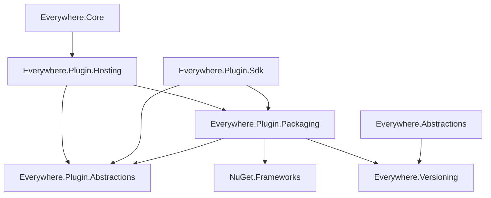

# Plugin Engine Specification

This document defines the product contract and architecture. [Plugin Developer Guide](02-PluginDeveloperGuide.md) describes author responsibilities and available APIs. [Validation](03-Validation.md) records the evidence, deployment measurements and remaining release gates. These documents replace chronological implementation reports.

**Design status (2026-10-13):** the SDK authoring model, host-import workflows, plugin/entry boundaries, platform selection and package installation/update contract in section 8 are agreed and ready for implementation. Design completion does not mean implementation completion or an immutable specification. Implementation may expose constraints that require substantial design changes. Record those findings, revise the affected contracts and developer instructions, and close the implementation and validation work before final merge.

**Workspace implementation status:** the rewrite includes `Everywhere.Plugin.Hosting`, BCL-only contracts in `Everywhere.Plugin.Abstractions`, and a buildable initial SDK. Tests cover selected-file loading, optional dependency reconstruction, lifecycle cleanup and collection, ZIP installation, RID selection, directory/source SDK imports, and resource satellites. The application now imports original ZIPs and unpacked package folders at startup and supports reversible navigation contributions. A real packaged AXAML/I18N sample passes headless rendering and cleanup checks. Its remaining Avalonia property-metadata roots have been identified, and an isolated probe confirms collection after public-API cleanup; production integration of that cleanup is pending. Desktop manual validation, complete package management and the SDK release remain pending. Historical probe results are distinct from validation of the rewrite.

**Status terminology:** implemented means code exists in the rewrite, not that every release gate has passed. Experimentally validated means demonstrated by the recorded probes only. Agreed / pending implementation defines the intended contract. Historical milestone descriptions elsewhere in this document do not establish that their entire regression suite has been ported. Open implementation decisions and incomplete capabilities must not be presented as supported features.

| Area | Current status |
|---|---|
| Selected-file metadata validation, DAGs and dependency-first preparation | Implemented; broader graph and replacement regression coverage remains |
| Cooperative lifecycle, registered cleanup, affected-consumer replacement and collection checks | Implemented and tested with real collectible fixtures; startup/shutdown connected, desktop validation pending |
| Same-DLL optional methods/types, name-based resolution and whole-consumer reconstruction | Implemented; optional availability transitions tested |
| Optional declarations, `RequiresPlugin`, `IPluginContext.Plugins` and `IPluginCatalog` | Public contracts and runtime checks implemented; SDK declaration generation and analyzers pending |
| SDK host imports, plugin/entry model and platform selection | Fixture directory/source imports tested; full Windows build-directory import packages the AXAML sample; cross-platform validation pending |
| Platform skipping and native loading | Implemented; unsupported entries stay enabled but skipped; Windows lazy native resolution and release tested with real DLLs  |
| Public contract migration, SDK analyzers, generated manifests and packaging | Contracts and simple single-entry ZIP generation implemented; analyzers, multi-entry aggregation and complete asset policies pending |

## 1. Product contract

Everywhere plugins are trusted, full-power .NET code running in the application process. They may directly reference Everywhere and other plugins, exchange shared types, use reflection or supported runtime patches. Assembly loading contexts are not a security sandbox.

The first release targets ordinary managed plugins, direct references, supported non-generic method hooks and complete lifecycle failure handling. Generic method patching remains a separate capability with its own validation; it is not a prerequisite for the rest of the plugin system. Windows and macOS deployment support must be demonstrated on actual published applications; Linux follows host support.

Independent unloading is attempted when it can be confirmed. No promise is made to force-stop arbitrary plugin code, undo arbitrary side effects, or unload every native dependency. A process restart is the fallback for uncertain shutdown, cleanup or collection. Restart does not fix an invalid dependency set or add support for an unsupported patch target.

The official author workflow uses project declarations and build tooling to generate package metadata. Neither humans nor agents should maintain manifest JSON by hand. The SDK records build facts; authors declare permitted runtime compatibility; tests record the combinations actually checked. The loader validates constraints without claiming that a permitted version has been proven compatible.

External dependencies are allowed when justified by functionality, maintenance, platform compatibility and runtime lifetime behavior. There is no dependency-free requirement. Framework compatibility uses NuGet.Frameworks. Host, Plugin API and logical plugin versions use Everywhere.Versioning. Patch libraries are optional plugin dependencies, not SDK/runtime defaults.

### Design references and attribution

tModLoader provided part of the design inspiration, particularly optional dependencies and conditional code/type discovery. Its `weakReferences`, `JITWhenModsEnabled` and `ExtendsFromMod` conventions are useful references; Everywhere defines its own availability, lifetime and reconstruction contract rather than adopting those names or treating their behavior as an unload guarantee. See the [tModLoader weak-reference guide](https://github.com/tModLoader/tModLoader/wiki/Expert-Cross-Mod-Content).

tModLoader is [MIT-licensed](https://github.com/tModLoader/tModLoader/blob/stable/LICENSE), copyright 2019 tModLoader Team. Design inspiration does not require relicensing Everywhere. Any future reuse or adaptation of substantial MIT-covered implementation must retain the applicable copyright and permission notice and record its source in third-party notices. This attribution does not claim that Terraria code/assets or every third-party component have the same license.

## 2. Identities and ownership

Keep the following identities separate:

| Identity | Meaning |
|---|---|
| Plugin ID | Installation, enablement, lifecycle and author-facing dependency identity |
| Package ID/version | Distribution and version-selection unit; it can contain several assemblies |
| CLR assembly identity | Simple name, AssemblyVersion, culture and public-key token |
| Artifact fingerprint | Exact file hash; MVID can provide additional diagnostics |
| Assembly owner | The loading context that owns an assembly instance |
| Active generation | The concrete selected artifacts currently loaded |

A plugin has one stable ID, one plugin version and one enablement, update and lifecycle identity. Its package declares either one universal entry or mutually exclusive platform entries. An entry identifies an assembly and the full name of its concrete IPlugin type. Exactly one entry is selected for an activation; supporting libraries do not need lifecycle entrypoints. Several projects may build one plugin. Features that need independent enablement, updates or lifecycles should use separate plugin IDs.

For loader-managed ordinary managed assemblies, select at most one active assembly instance per simple name. Different versions are not separate namespaces. Return the same selected Assembly instance to every consumer so shared types remain identical.

Host assemblies, the lifecycle contract and host runtime dependencies belong to Default, including host files not loaded yet. A deployment catalog reserves those identities. Never distribute a competing plugin-owned copy of the host ABI or redirect Default's static dependencies into collectible plugin contexts.

The current implementation assigns one collectible AssemblyLoadContext to each plugin-managed DLL. This is an implementation choice pending representative-scale validation, not a public packaging contract. Plugin identity must not be equated with DLL or context identity. Coarser ownership may be considered without weakening dependency or version rules; existing assemblies cannot migrate between contexts.

Trusted plugin code can bypass the registry through other loading APIs, runtime emit or native code. Global uniqueness is guaranteed only for the loader-controlled universe. Native assets and generated assemblies need separate policies. Resource-only satellite assemblies are declared in the selected entry's managed asset list, identified by PE assembly name and culture, and loaded into their parent assembly's collectible context. They do not compete as ordinary global simple-name nodes. A different resource set changes that parent's selected content and requires reconstruction. Directory names do not identify a language or determine ownership.

## 3. Selection and static validation

Inspect installed candidate files without executing plugin code. PE metadata provides definitions, references and entrypoint information; package/build records provide provenance and runtime constraints. Verify generated declarations against the actual files. The engine's content fingerprints identify selected artifacts and generations; they do not require a new signed or hash-locked host manifest. Distinguish runnable DLLs from compile-time reference assemblies and platform-specific assets.

Reserve the real host deployment catalog first. Select the package assets applicable to the current host platform, process architecture and runtime before constructing the assembly graph. Then select one consistent set of installed runnable assets for the entire desired plugin set. Runtime NuGet restore or package downloading is outside the loader's responsibility. Package selection must preserve multi-assembly package consistency.

Four kinds of version information must remain distinct:

| Information | Interpretation |
|---|---|
| Exact build selection | Reproducible provenance, not a compatibility promise |
| Author-declared runtime range | Versions the author permits selection of |
| Tested combinations | Evidence for named versions, platforms and tests only |
| Active selection | Artifacts actually chosen for the current installation/process |

Package version, AssemblyVersion and file content are not interchangeable. Several package releases can share AssemblyVersion. A matching package range cannot override incompatible CLR identity, target platform, culture or public-key token. Do not turn every transitive lock-file result into an exact runtime pin or infer unlimited compatibility from missing provenance.

For ordinary additions, preserve valid active selections. Choose new candidates deterministically and explain the choice. Do not select by directory enumeration order. Differing bytes under one name require an explicit provenance-based selection or an ambiguity error. The current selected-file API rejects that ambiguity; it does not implement candidate solving.

**Agreed / pending implementation:** required versus optional dependencies, conditional code and availability queries are defined below; host-import, entry selection and host-range policies are defined in section 8. The shared version/range implementation and prerelease comparison are implemented. Complete schema coverage, dependency-range defaults and candidate ranking still require implementation decisions and tests. These unresolved details do not override the settled host-range policy. Agreed names do not imply that SDK targets or APIs already exist.

## 4. Graph and loading rules

### Required and optional dependencies

An edge A -> B means A depends on B. Ordinary dependencies are required and prepared eagerly. Explicitly optional dependencies may be unavailable while A's unconditional code remains usable. Optional does not mean that B must wait until its first method call to load, and there is no plugin-wide `LazyLoad` switch.

Keep two relationships distinct:

- Declared dependencies record what A may use, including optional B when it is absent. Retain these declarations so enabling B can identify A as a consumer that needs reconstruction.
- Active dependencies record the bindings selected for this activation. A selected optional B participates in preparation, initialization and shutdown ordering just like a required dependency.

Validate the active assembly graph, plugin lifecycle graph and any derived graph between owners before creating plugin contexts. Reject directed cycles with a concrete path. Optional edges do not excuse a cycle when they become active; do not silently drop a selected edge to break one. Do not make cyclic inputs acceptable by grouping them into one context.

A diamond, A -> B -> D and A -> C -> D, is valid. Prepare D first, then B/C in a stable order, then A. Host/framework dependencies terminate at the fixed host catalog; their internal graph is outside the plugin cycle policy.

Create and load dependency owners before consumer owners. Sorting InitializeAsync calls alone is insufficient. Serialize coordinated preparation and reuse unchanged owners for additions. CLR resolution callbacks return already selected/prepared instances; they must not create unplanned owners or silently fall back to an unrelated assembly.

Only explicit optional declarations with properly isolated conditional code permit missing references in a selected DLL. Unclassified references remain required; the loader must not infer optionality from arbitrary branches or swallowed load exceptions. A separate integration DLL remains a useful independently removable boundary, but is not required for conditional methods or derived types within A's entry DLL. Unselected platform implementations do not enter the active graph. An OperatingSystem check alone does not remove a static dependency. Unrelated nodes use a stable tie-break so loading order is reproducible.

Static graphs define the planned update set, not every CLR lifetime relationship. Shared generics, dynamic loads, delegates and caches may introduce additional runtime relationships. Dependency-first creation improves tested generic lifetime behavior; collection must still be verified.

### Conditional methods and types

**Agreed / pending implementation:** `RequiresPlugin("plugin.id")` marks a type or method whose use requires that declared plugin dependency to be available. A type-level condition applies to its members and nested types; member conditions add to enclosing conditions. Multiple requirements mean all must be satisfied. Referring to an undeclared dependency is a build validation error.

The attribute is metadata for SDK checks and loader discovery, not a CLR execution barrier. Calls from unconditional code must check availability and cross an explicit `MethodImplOptions.NoInlining` method boundary. The attribute does not inject that check, rewrite IL or automatically prevent inlining. Optional types, including types deriving from B's public base classes, may reside in the same DLL as A's ordinary entrypoint.

Read conditions from PE metadata before materializing runtime types, inspecting their optional base/interface/signature types or constructing instances. Do not discover eligible types by unconditionally calling `Assembly.GetTypes()` and filtering afterwards. Any engine-controlled method preparation must respect the same conditions. No general eager pre-JIT phase is required by this contract.

Entrypoints and unconditional paths must remain valid without optional dependencies. Keep optional types out of their base classes, interfaces, fields, signatures and generic constraints. Analyzers must diagnose supported violations and missing isolation boundaries; async state machines, lambdas, nested types and generated code need explicit coverage. Neither metadata checks nor analyzers claim to prove arbitrary reflection or third-party scanning safe.

### Name-based dynamic loading

**Agreed / pending implementation:** support `Assembly.Load(name)` when the call enters the controlled resolution path. It uses the same selected identities and declared dependencies as static binding. A plugin ID is not an assembly name. Loading an assembly does not enable a plugin or complete its initialization, and resolution must not mutate the lifecycle plan.

Declarations must also cover name-based dependencies with no static reference, including bindings made by plugin-owned supporting libraries. The resolver needs the requesting owner's allowed assembly set, not just a process-wide name lookup. Return the selected instance; reject unavailable, undeclared or incompatible plugin bindings instead of probing another file or falling back to an unrelated Default copy. CLR cache hits can bypass resolution callbacks, so callback logs are not a complete dependency graph or security boundary.

Calls from Default-owned shared libraries may require a narrowly scoped contextual-reflection environment associated with the plugin. Restore the previous environment afterwards. Shared-owner constraints and any dependency actually bound by a supporting library must participate in the affected set; do not attribute all such bindings only to the entry DLL. Async propagation, concurrent calls and representative third-party packages still need production validation.

No `PluginContext.LoadAssembly` wrapper is planned for these supported name-based scenarios. This is not a global interception guarantee: `LoadFile`, byte-array loading, custom contexts and other bypasses remain outside controlled ownership guarantees. Generated assemblies require their own lifetime assessment; their existence alone does not establish either a leak or safe unloading.

**Implementation boundary:** the rewritten `PluginLoadPlan` permits explicitly declared unavailable optional references, validates entry conditions from metadata, and computes each owner's allowed bindings. `AssemblyRegistry` rejects unplanned bindings instead of falling back to unrelated Default copies. Real fixtures exercise optional calls, same-DLL derived types, name-based loading and availability reconstruction. Comprehensive analyzers, discovery facilities and third-party dynamic-loading coverage remain incomplete. [Validation](03-Validation.md#historical-findings-and-their-limits) distinguishes historical findings from current regression coverage.

## 5. Lifecycle and cleanup

The lifecycle separates reversal of application changes from disposal of plugin-owned resources.
IPlugin requires only InitializeAsync. An entry may additionally implement IDisposable or
IAsyncDisposable; the runtime discovers and invokes one disposal interface when retiring that
instance. Keep constructors free of externally visible work and make disposal tolerate partial
initialization. Entry disposal, registered reversal and ordinary DI exit integration are implemented.

### Plugin information and availability

**Implemented:** `IPluginContext` exposes `IPluginCatalog Plugins { get; }`. The read-only catalog has the following core operations:

```csharp
public interface IPluginCatalog
{
    bool IsAvailable(string pluginId);

    bool TryGetInfo(string pluginId, [NotNullWhen(true)] out PluginInfo? info);
}
```

`IsAvailable` is relative to the calling plugin's declared dependencies and this activation's selected bindings. It is true only when the selected dependency satisfies compatibility requirements and has successfully initialized. A declared optional dependency that is absent, disabled or incompatible is unavailable. Querying an undeclared dependency is an API error; SDK diagnostics should catch constant-ID cases before runtime. An unavailable required dependency prevents activation instead of leaving a normally running consumer with a false result.

`TryGetInfo` queries any plugin known to the host without loading it, enabling it or adding a dependency edge; an unknown ID returns false. `PluginInfo` is an immutable host-owned snapshot containing identity, version and status information. `IsEnabled` means the desired configuration requests enablement. `State` is `Inactive`, `Initializing`, `Active`, `Stopping`, `Failed` or `Skipped`. `SkipReason` is nullable and currently defines `UnsupportedPlatform`. These states describe lifecycle progress, not verified physical collection.

An enabled plugin can be `Skipped` because no platform entry matches. Skipping does not create a plugin instance, load its managed/native code, or validate the foreign entry against this host version/framework. The package declaration and installed paths must still be valid. An optional dependency on it is unavailable; a required dependency prevents the consumer set from activating. Disabling the skipped plugin returns its snapshot to `Inactive`. A selected entry with incompatible host/API/framework constraints is rejected, not skipped.

An enabled plugin can have failed initialization. A globally active plugin can be incompatible with A. Neither `IsEnabled` nor `State` is a substitute for A's `IsAvailable` check. Do not expose an ambiguous `IsLoaded` Boolean as a readiness test. Physical assembly residency belongs in diagnostics. Snapshots must not retain plugin instances, Assembly, Type, MethodInfo, delegates or exception objects.

Determine A's optional bindings before starting its initialization; selected dependencies finish initialization first. Preserve those bindings throughout A's normal activation. Do not replace B between A's availability check and a supported call. When B changes, stop and drain A before stopping B. The check itself is not an operation lease: once A receives Stopping, it must reject new work and await existing work under the ordinary shutdown contract.

Availability changes use whole-consumer reconstruction, not in-place rebinding of an existing context. No dependency-change event is required for the first API: a newly initialized A queries its new binding set. Catalog snapshots are observations, not handles that extend a dependency's lifetime.

### Resource ownership

**Implemented.** Reversing an
application change and disposing a plugin object have different purposes, even when both use
IDisposable or IAsyncDisposable. Keep the names Register and PluginResource; registration accepts
resource objects, not a new undo-action interface.

| Responsibility | Meaning | Hot unload | Ordinary process exit |
|---|---|---|---|
| Registered change reversal | Dispose handles that undo plugin-owned application changes, such as subscriptions, navigation contributions or patches | Required for retiring owners | Not performed automatically |
| Plugin object disposal | Stop owned work and release files, buffered output, connections and other resources belonging to the instance | Required when implemented | Invoked when implemented through the normal disposal path |

Every plugin-owned change to shared application state that must disappear when the plugin is removed
must have an explicitly owned reversal registered with its activation or assembly. If a host or framework
API already registers that reversal on the plugin's behalf, do not register it again. A returned
disposable handle can represent the reversal: disposing a navigation-registration token removes the
navigation item, while disposing a StreamWriter ends file output. The shared .NET interface does not
make their lifecycle responsibilities interchangeable. A modification without a supported reversal
cannot be promised safe hot unload. Persistent plugin data and intended external effects are not
implicitly rolled back; registration is not a transaction over arbitrary file writes or remote actions.

An activation and an assembly loading instance each own a separate PluginResource container.
IPluginContext.Register delegates to the activation container. Static PluginResource registration
selects the assembly container independently of which plugin first triggered its initialization.

```csharp
public void Register(object resource);
public static void Register<TOwner>(object resource);
public static void Register(Type owner, object resource);
public static void Register(Assembly owner, object resource);
```

These are the existing signatures. Each object must implement IDisposable or IAsyncDisposable.
Registration is synchronous; there is no RegisterAsync API. Disposal prefers IAsyncDisposable when
both are implemented, even if the expression was typed as IDisposable. Only one interface is called.
Register each reversal once, immediately after acquisition. The same handle must not also be disposed
by plugin object cleanup unless repeated disposal is explicitly supported. Rejected registrations
remain caller-owned. Do not register the plugin entry itself as a substitute for entry disposal.

An activation registration belongs to that particular entry instance. An assembly registration belongs
to that particular loaded DLL, not to its first consumer. Use a type defined in the intended library as
the owner marker. The generic and Type overloads select the assembly defining the supplied type, not
its generic arguments or the resource object's runtime type. Host assemblies and independently loaded
DLLs without managed ownership are rejected; there is no implicit process-wide fallback container.
Different loads of the same DLL have different containers. Hosting attaches the weak-key association
before module/static initialization can run and removes it after successful cleanup. Only Hosting
establishes associations; Abstractions has no Hosting dependency.

A shared assembly's registrations survive removal of one consumer while another still needs it.
Registrations made before a completed entry construction or initialization failure are also eligible
for reversal when their owners retire. A failed static constructor requires a fresh loaded type before
retry, which can require stopping shared consumers. A shared static object that needs process-exit IO
cleanup must have an explicit ordinary owner; static registration alone does not provide that callback.

PluginResource.Close prevents further registration without disposing existing handles. Disposal is
sequential and reverse-ordered within each container, outside its registration lock. It attempts the
remaining handles after exceptions and then aggregates failures. Repeated DisposeAsync calls do not
repeat disposal or join an in-flight first call; the lifecycle owner must await the original operation.
Host-managed container failures are converted to text before collection checks. Failed or timed-out
assembly reversal blocks dependency cleanup and requires restart. Timeout does not abort code; retain
unfinished operations and their owners. UI-bound reversal handles must dispatch their own cleanup.

Hot retirement proceeds in this order: close activation registration and signal Stopping, await
optional entry disposal, reverse activation registrations, then reverse retiring assembly registrations
in dependency order before requesting unload and checking collection. Entry disposal must reject new
work and await existing users before releasing their resources. Registered handles must remain usable
after entry disposal: removal tokens own the state needed to remove contributions. An entry must not
destroy state that its later reversal still requires. If a reversal and entry disposal both release the
same underlying resource, its single owner must coordinate release; the engine cannot infer sharing
inside callbacks. Asynchronous release that can overlap must share completion, not merely mark itself
started. The engine does not repeat registered reversals, which need not be safe to execute twice.

Failure or timeout during entry disposal prevents subsequent reversal and requires restart: completion
of background users is no longer established. A cancellation callback failure still allows entry
disposal to be attempted, but retirement remains failed. Reversal failures attempt the remaining handles
in that container and then require restart. No incomplete callback is overlapped with resource cleanup.

A caller-created new PluginResource() is an ordinary resource container. Its caller chooses when to
close and explicitly dispose it. The process-exit policy applies to the engine-managed activation and
assembly containers, not to all uses of the PluginResource type.

### Plugin object disposal and process exit

A plugin entry may implement IDisposable or IAsyncDisposable when it owns resources needing final
cleanup. Prefer IAsyncDisposable when both exist; invoke one interface, not both, and never fall back
to Dispose after DisposeAsync fails. Entries without such work need neither interface. Finalize the
instance on hot removal/replacement, completed initialization failure and ordinary application exit.
Do not register the entry in a reversal container. A constructor that throws cannot supply an instance
for disposal; static registrations still follow their assembly ownership.

PluginActivation retains the single instance-disposal task and its host-owned diagnostic text. Exit
joins a disposal still running after a hot-unload timeout, rather than invoking the entry again. A
failed disposer is not retried; a subsequent reversal failure does not change its successful result.
Exit signals Stopping before joining a still-running initializer; initialization must finish before
instance disposal can begin. Plugin code owns stopping and draining
its background users; the engine cannot discover those users automatically.

Normal exit follows existing DI ownership: the container captures PluginApplicationService through
its IAsyncInitializer registration and invokes its IAsyncDisposable implementation. That service owns
and disposes PluginEngine. There is no IAsyncShutdown or application-wide pre-exit service phase.
The existing application entry points drain startup/activation ingress and asynchronously dispose DI
after the Avalonia lifetime returns. Entry disposal must not require a live UI dispatcher or resolve new
services from the disposing provider. Capture necessary dependencies during initialization and respect
their actual ownership; final cleanup must not assume every other service is still usable.

The startup coordinator starts initializer groups on the UI thread but awaits their completion without
capturing its synchronization context. Later UI steps use cancellable dispatcher operations, so the
coordinator can finish after exit cancellation without requiring another UI continuation. Individual
initializers still own cancellation of their asynchronous work; this does not forcibly stop them.

Engine disposal rejects new mutations, waits for the current mutation, then disposes remaining entries
sequentially in reverse dependency order. A failed consumer leaves its dependencies intact; independent
entries are still attempted. Failures escape as host-owned diagnostic text in a host exception, and
PluginApplicationService logs them so DI can continue releasing other host services. Repeated engine
disposal joins the same task. RestartRequired does not suppress this final attempt.

Process exit skips both registered reversal queues, patch/UI removal, assembly unloading, forced GC and
collection checks. Installed callbacks can remain until termination and must tolerate their owner
having stopped. This fast-close path avoids hot-unload work; it is not a fixed-time guarantee. There is
no engine exit timeout or public ShutdownDiagnostics collection. Ordinary asynchronous disposal waits
for completion, so an uncooperative initializer, stopping callback or disposer can delay managed exit.
The engine does not abort plugin code or pretend that a returned timeout means its work has stopped.
Save important data during normal operation; forced termination and OS shutdown cannot guarantee
disposal delivery or persistence. Native platform exit behavior still needs platform validation.

### Avalonia registration lifetime

**Resource foundation implemented; framework integration remains under investigation.** The earlier
plan to enumerate every retiring assembly's types and call UnregisterByModule is superseded as the
general solution. That API collected the current sample in an isolated experiment, but does not
cover all property/event registrations or hidden subscriptions, and full type enumeration conflicts
with dormant optional dependencies.

The candidate approach is to record framework registrations when they occur and associate their
reversal with the correct assembly resource container. Third-party controls must continue using
ordinary Avalonia APIs; requiring PluginUtils replacements is insufficient. Hosting supplies ownership
and ordered cleanup, while Avalonia-specific interception/reversal belongs to the framework/host
integration. Shared-library registrations survive individual consumer activations. PluginResource
alone does not capture registrations, implement their reversal, or establish custom-control unload
support. Coverage, framework patch strategy and reversal semantics remain to be validated before
this integration is considered designed and implemented.

The current sample still reports RestartRequired under production cleanup. Keep this fallback and
explicit plugin-owned UI disposal. See [Known issues](03-Validation.md#known-issues) for property
registrations, AddOwner, class handlers, layout/render helpers, routed events and host-type mutations.
Do not clear framework tables or host types indiscriminately.

### Plugin settings

**Persistence and migrations implemented; UI registration remains separate work.** Plugins may reuse
context.OpenSettingsAsync with an independent document, explicitly supplied serializer options and
a generated descriptor provider. SettingsEngine<TSettings> owns the returned document lifetime;
SettingsInitializer is the internal application startup adapter. The entry owns final saving; migrations
use temporary DI ownership and finish cleanup before committing the document. See the [settings specification](05-SettingsSpecification.md).

## 6. Applying changes and failures

Validate the entire desired set before stopping current plugins. Compare selected content, entrypoints, payload ownership and dependency relationships. Reuse unaffected activations. For removal/replacement, expand the affected set through reverse assembly dependencies, plugin lifecycle dependencies and any co-owned assemblies until stable.

**Agreed extension / pending implementation:** compare each consumer's old and proposed optional bindings as well as active edges. Enabling a previously absent B, disabling B, changing compatibility or replacing B's selected artifacts can require reconstructing all of A, including its entrypoint and affected owners. Include supporting libraries that bind B and their consumers. Preserve unrelated activations where ownership permits. Never attempt to remove individual methods, base types or established bindings from a surviving context. Declared-but-absent relationships are needed to detect the enablement case; the current required-only reverse graph is insufficient.

Stop consumers before dependencies. Release all loader-owned roots to the unload set, request unload for its owners, then verify weak references outside frames retaining collectible objects. Do not demand that a dependency collect while its consumers are still rooted. Create replacements only after required old owners are confirmed collected.

Stage updates separately from active files and verify the bytes loaded against the inspected hashes. Do not overwrite active generation files as the update mechanism. Section 8 defines installation directories and persisted selection; publishing an installed directory is distinct from successfully applying a runtime change.

| Result | Required meaning |
|---|---|
| Applied | The requested set is active |
| Rejected | Preflight failed; existing plugins were not stopped |
| ActivationFailed | New activation failed, its new activations/resources were stopped and new owners collected; a later explicit Apply is permitted |
| RestartRequired | Shutdown, cleanup or required collection is unconfirmed; further plugin changes are refused |

An initialization exception can recover if initialization has completed and all subsequent shutdown, cleanup and collection steps succeed. A load failure can recover after releasing any owners already created. Retry is explicit, not an automatic loop. Existing unaffected plugins remain active. Old activations stopped for an update are not automatically resurrected if the new generation fails.

Optional means that a dependency can be excluded before activation; it does not mean ignoring a selected dependency's initialization failure. If selected B fails initialization, fail the attempted activation and clean up under the same rules. Do not continue initializing A with a silently changed binding set. An explicit later plan without B is permitted only after cleanup and required collection have been confirmed. If confirmation fails, require restart.

ActivePluginIds describes initialized activations that have not been stopped; its absence does not prove a failed plugin has no code or effects remaining. ResidentAssemblyNames includes loaded or unconfirmed owners. Diagnostics must distinguish behavior restoration, patch disposal and physical collection.

The application must not present RestartRequired as successful disablement. It must refuse further plugin changes, accurately explain what remains uncertain, and use the application's save-work and restart workflow. Final process-exit disposal is still permitted; it does not clear RestartRequired or retry failed cleanup. That UI and actual restart integration remain to be implemented. Failure handling does not forcibly contain full-trust plugin code.

Bound collection attempts and document their cost. Full GC and pending finalizers are not a strict wall-clock deadline. A surviving weak reference means collection was unconfirmed, not proof of a permanent CLR leak. Collection success does not prove reversal of every side effect.

## 7. Runtime patches

Runtime patching is an optional plugin capability, not a built-in SDK or engine service. Plugin authors that need it add MonoMod.RuntimeDetour or another patch library to their own projects. Neither Everywhere.Plugin.Sdk nor Everywhere.Plugin.Hosting takes a default dependency on a patch library. RuntimeDetour Hook is the documented starting point for the non-generic scenarios supported by the recorded experiments. Other direct techniques remain possible for trusted plugins, but must not inherit unsupported unload guarantees from the engine.

Patch libraries follow the ordinary package, shared-assembly and compatibility rules. The SDK does not give them a special ownership model or automatically put them in Default. A library's successful use from Default in an experiment does not prove the same behavior when it is loaded as a plugin-managed shared dependency; that deployment needs separate validation.

The plugin registers patch handles as reversal of its application changes through the ordinary context resource APIs. Disposal of a hook handle reverses a patch; disposal of the entry releases its own resources. These responsibilities must not dispose the same handle twice. It must use the library's explicit ordering facilities, handle conflicts, stop accepting new plugin work and await in-flight callbacks during shutdown before registered resources are disposed for hot unload. Multiple plugins may patch the same target; removing one must dispose only its own handles and preserve the remaining chain. A stopped callback that passes through to the original method is still an installed patch until its handle is disposed. During process exit, registered hooks can remain installed until termination, so stopped callbacks must remain safe if the host calls them again. The engine provides cooperative lifecycle, hot-unload cleanup and collection checks; it does not inspect arbitrary hooks or automatically wrap their callbacks.

Generic method patching, inlined callers, mixed Hook/ILHook chains, native targets and startup rewriting have separate capability requirements. The tested Hook constructor rejects closed generic method targets. Loading generic types successfully does not establish generic patch support. Profiler instrumentation and alternative rewriting approaches remain research options, not supported developer instructions.

## 8. SDK, metadata and plugin organization

### Components and version boundaries

**Project split implemented; complete SDK and runtime capabilities remain subject to the status and release gates in this specification.**

| Component | Responsibility |
|---|---|
| `Everywhere.Plugin.Abstractions` | Host-owned lifecycle, context, catalog and declaration contracts, referencing the BCL without host implementation, UI or patch-library dependencies |
| `Everywhere.Plugin.Sdk` | NuGet-distributed MSBuild SDK, templates, host-reference import, analyzers, generated metadata and packaging |
| `Everywhere.Plugin.Packaging` | Shared manifest and host-descriptor models, JSON handling, package paths, host-reference import, version/framework compatibility and portable RID selection |
| `Everywhere.Plugin.Hosting` | Source discovery and installation, runtime selection/validation, resolution, activation, cleanup and collection verification |

`Everywhere.Plugin.Hosting` is the runtime project/assembly/namespace. Engine types such as `PluginEngine` retain their descriptive names. The public developer contracts belong in `Everywhere.Plugin.Abstractions`. The SDK references Packaging and Plugin.Abstractions directly; it does not reference Hosting or carry the loader as a tooling dependency. Packaging references Plugin.Abstractions, Everywhere.Versioning and NuGet.Frameworks, and never references Hosting, Core or the SDK. Everywhere.Abstractions also references Everywhere.Versioning. The version types have one assembly identity, with no linked-source copies or type forwarding layer.



Within Hosting, `Installation` owns `PluginSourceCatalog`, `PluginPackageStore` and `PluginInstallation`; `Loading` owns PE inspection, load planning and assembly contexts; `Lifecycle` owns activation, context resources and catalog views. Shared `PluginValidationException` belongs to Packaging so both build-time and runtime validation use the same diagnostic contract without a reverse dependency. Installation state is not part of the shared package declaration model.

`Build.Plugin.Hosting.targets` is imported by platform application projects to export the host reference contract and publish its descriptor. The descriptor remains `plugin-host.json`; the build target names and serialized formats are unchanged. `PluginApplicationService` and Avalonia-specific integration stay in Everywhere.Core. A developer's plugin uses Abstractions and any explicitly needed host APIs; SDK tool dependencies are not automatically runtime dependencies of that plugin.

Lifecycle contracts reside in the single abstraction assembly; do not introduce a second incompatible IPlugin identity. The SDK supplies compilation references to the appropriate contract, but a plugin package must not carry a competing runtime copy. This narrow contract dependency policy does not prohibit justified external dependencies in the SDK or engine.

The intended project form is `<Project Sdk="Everywhere.Plugin.Sdk/<sdk-version>">`; SDK version selection through `global.json` is also possible. The SDK will compose the required .NET build behavior. This describes the intended distribution model, not an already published package or installation command. See [MSBuild project SDKs](https://learn.microsoft.com/en-us/visualstudio/msbuild/how-to-use-project-sdk).

Keep these version concepts separate:

| Version | Contract |
|---|---|
| Plugin version | One exact version for the whole plugin, including all platform entries |
| SDK version | The build tools used; not a runtime compatibility gate |
| Plugin API version/range | The public contract provided by the host and accepted by the selected plugin implementation; independent of engine implementation releases |
| Everywhere version/range | Host build identity and permitted host versions for a concrete entry implementation |
| Dependency versions/ranges | Exact build choices and permitted runtime choices for other plugins/packages |

Several Everywhere releases may provide the same Plugin API version. Direct use of host implementation APIs is not covered by Plugin API compatibility alone. Runtime validation checks the effective contract requirement and any host constraint for the selected entry. Do not generate a redundant engine-implementation version requirement merely because the SDK and host were built together.

`hostVersion` belongs to the concrete universal entry or each platform variant, not the plugin root. Different entries of one plugin may permit different Everywhere ranges. For entries that reference host implementation APIs, local development may omit the range while recording the exact imported host build; distribution packaging requires an explicit permitted range. Tooling may help authors declare the exact current version as a conservative starting point, but must not silently infer compatibility with future releases. If supporting this distinction proves impractical, requiring explicit ranges during development as well is an accepted fallback; update the tools and documentation together before merge. Contract-only plugins need a Plugin API requirement, not an artificial host-release restriction.

The public Plugin API preserves backward compatibility within a major version. For a stable build contract such as 1.2.0, the SDK defaults to [1.2.0,2.0.0-0); the upper bound excludes all prereleases of the next major as well as its stable release. Authors may set EverywherePluginApiVersion to a tested range including the imported contract. Prerelease contracts default to an exact range, such as [1.2.0-preview.2]. This promise applies to Everywhere.Plugin.Abstractions, not host implementation APIs or third-party packages. Both defaults are implemented and exercised through SDK packaging tests.

Host, Plugin API and logical plugin compatibility use the same SemanticVersion and SemanticVersionRange implementation from Everywhere.Versioning (public namespace Everywhere.Common). See [the shared version contract](../Versioning.md). Version ordering never consults UpdateChannel. Unknown prerelease labels are valid; numeric label segments compare numerically, text segments compare ordinally without case, and metadata after + does not affect comparison, equality or exact ranges. Historical release tags and settings migration versions retain their order.

Ranges support exact [v], bare inclusive minimum v, and open/closed intervals with optional bounds. There is no additional prerelease-admission filter: [1.0,2.0) includes 1.5.0-preview and 2.0.0-preview. Use an upper bound of 2.0.0-0 to exclude the entire next-major prerelease series. Empty declarations and floating expressions are rejected. A range expresses compatibility with an already selected installation; it does not select/download another version or retry an older provider.

NuGet package restore and CLR assembly binding remain separate layers. PackageReference versions are interpreted by normal NuGet restore, not the Everywhere version parser; resolved assets supply build inputs. AssemblyVersion and AssemblyRef retain their numeric CLR identities. Build commit or MVID can aid diagnostics, but neither replaces compatibility declarations. No additional signature or hash-lock workflow is required for ordinary development.

### Two host-import workflows, shared ownership and packaging rules

Support importing either an installed/extracted Everywhere distribution or a specific Everywhere source project. These are the first-release host-reference workflows; a separate host-reference NuGet distribution is not required. Support starts with the first Everywhere release that exports the plugin import contract. Earlier releases fail with a useful diagnostic rather than a recursive directory-scan fallback.

An installation import accepts the application directory or a macOS `.app` root. Resolve the known bundle layout and read its declared files without executing the application or loading its native libraries. An archive must first be extracted. A Windows developer may import an extracted macOS application; importing references is distinct from running that host.

A source import uses standard ProjectReference resolution for compilation, including transitive NuGet compile assets and reference assemblies. This is the preferred workflow for developers working with host source. Installation imports remain a convenient local-development path using the distributed assemblies. Both workflows share host identity, ownership, compatibility and packaging rules; they do not need the same compilation-reference pipeline. The host descriptor and runtime dependency records remain necessary for package exclusion even when compilation uses project references.

**Implemented; Windows validated:** the SDK adds the selected source host as a ProjectReference during project evaluation, so restore and compilation use the normal .NET graph. Only compile assets flow from the host's NuGet dependencies; plugins declare their own packages when they need build targets, analyzers or runtime assets. The host exports its restored project-reference paths so implicit transitive references also receive host ownership and property isolation. Configuration and Platform retain normal project-reference behavior, and MSBuild negotiates target frameworks. Plugin identity/version, output paths, RID and deployment overrides are removed when building host-owned projects. The SDK reads the host descriptor through the same resolved project configuration instead of launching a nested dotnet build.

The runtime ownership list used for packaging includes declared framework runtime-pack assemblies; installation compilation references exclude those implementations. This distinction prevents Windows SDK runtime files from being repackaged without substituting framework implementation DLLs for compiler references. Host-owned project outputs, symbols, XML and copied content are not copied into the plugin payload. The final package still checks managed identity/version compatibility, including plugin-owned package references that overlap host dependencies.

Source access does not remove platform SDK/workload/toolchain requirements. The current host build still executes its ordinary prerequisite targets, including Watchdog publishing; a managed-reference-only host build remains pending. Do not silently change target frameworks or omit required functionality to make a cross-build appear successful. Broader IDE and cross-platform validation remains a release gate.

Use the host's `.deps.json` as the primary dependency record, and its runtime configuration for shared-framework requirements. It records package provenance and runtime asset relationships, but is not a replacement for PE AssemblyRef metadata or a complete plugin import protocol. Supplement only missing facts: plugin support/contract version, host build and platform identity, assembly roles, and necessary deployment-path mappings or exceptions. Do not maintain a second hand-written copy of the dependency graph. See [.NET dependency records](https://github.com/dotnet/sdk/blob/main/documentation/specs/runtime-configuration-file.md) and [runtime probing](https://learn.microsoft.com/en-us/dotnet/core/dependency-loading/default-probing).

Read assembly identities and references from the declared files. Paths in `.deps.json` may be package-relative although publish output is flat; resolve them through the known deployment layout, not by blindly concatenating paths or recursively guessing. Compile-only assets do not become host-provided runtime assemblies. Deduplicate records that resolve to the same assembly.

Classify the imported set as the plugin contract, platform host entry, other host-provided assemblies, and framework references. Host-provided third-party libraries follow the same ownership policy as first-party host libraries. When a plugin also references one of those NuGet packages, reuse a compatible host assembly or diagnose the conflict; do not package another runtime copy as a workaround. Exclusion follows declared ownership and resolved identity, not a hard-coded `Everywhere.*` prefix or signing key. Preserve existing strong-name identities when present; introducing signing is not necessary for this classification.

The Windows and macOS projects currently both emit `Everywhere.dll`. They are alternative platform host entries with the same simple name, not two references to add to one compilation. Other host assemblies can also expose implementation APIs without being part of the stable plugin contract. Select the appropriate host set for each plugin build. Merely setting `Private=false` on a source ProjectReference does not exclude all transitive host outputs: the SDK must classify the complete resolved set and validate the final package.

### Local configuration and platform builds

Keep machine-specific host locations in an ignored local configuration file, with a tracked example. The SDK explicitly imports that file; CI can supply paths through build properties. Relative paths are allowed. Do not put absolute installation or checkout paths into distributed plugin metadata. Exact property/item names are implementation details until the SDK is available. Both installation and project imports must refresh when their declared inputs change rather than silently reusing stale references.

For an ordinary neutral plugin, use one project and one universal entry. For platform host APIs, use separate platform entry compilations, normally a common supporting project plus Windows/macOS entry projects referencing it. Each entry must target a framework compatible with its referenced host projects; declaring a platform RID does not replace framework compatibility. Neutral code references neutral host projects rather than the platform application entry. Share plugin ID/version declarations across those projects. Common code must not require the platform entry projects. Use standard target framework, RID and minimum-OS properties first; add plugin-specific declarations only for intent they cannot express. Build-machine OS checks must not accidentally select the wrong source for a cross-target build.

Allow separate host locations per target platform, including a mixture of source and installation imports. Missing macOS inputs must not block an explicitly Windows-only build. A package advertised to contain both entries must include and validate both; do not silently ship an incomplete package. Importing references, compiling managed code, building native prerequisites, bundling/signing and testing on the target OS are separate capabilities. Cross-platform compilation is an intended workflow where the underlying toolchain allows it, not a guarantee for every source checkout or project. The full Windows-to-macOS and macOS-to-Windows matrices remain to be verified.

### Generated entries and deterministic platform selection

Authors declare project/source intent; tooling emits JSON from resolved references and final runtime artifacts. The following is the agreed entry shape, not the complete package schema. Directory names and example version ranges are illustrative:

```json
{
  "id": "acme.clipboard",
  "version": "1.0.0",
  "entry": {
    "$type": "perPlatform",
    "variants": [
      {
        "platform": "win",
        "assembly": "windows/Acme.Clipboard.Windows.dll",
        "type": "Acme.Clipboard.Windows.Plugin",
        "hostVersion": "[0.9.0,0.10.0)"
      },
      {
        "platform": "osx",
        "assembly": "macos/Acme.Clipboard.Mac.dll",
        "type": "Acme.Clipboard.Mac.Plugin",
        "hostVersion": "[0.9.2,0.10.0)"
      }
    ]
  }
}
```

The universal form uses `"$type": "universal"` with `assembly`, `type` and any applicable `hostVersion` directly on `entry`. A plugin supporting only one platform uses `perPlatform` with one variant. `$type` discriminates the metadata shape; `type` names the lifecycle class. Paths are relative to the package root and must stay within it. No implicit assembly scan chooses an entrypoint.

`platform` uses canonical portable .NET RID spelling: `win`, `win-x64`, `osx`, `osx-arm64`, and so on. `macos` is not the chosen RID spelling even if used as a directory name. `win` is architecture-unspecified, not an alias for `win-x64`; it may only describe assets whose actual architecture constraints allow the selected process. Selection uses process architecture, including under emulation, rather than physical CPU alone. See the [.NET RID catalog](https://learn.microsoft.com/en-us/dotnet/core/rid-catalog).

The SDK and loader share the same versioned portable-RID selection rules:

1. Reject duplicate platform keys and malformed entry declarations.
2. Match the current process RID, then use compatible fallbacks from the portable RID graph. An exact `win-x64` entry takes precedence over `win`. This is graph-based matching, not string-prefix matching or JSON array order. Reject unresolved ambiguity. When no entry matches, preserve enablement and report `Skipped` / `UnsupportedPlatform`.
3. Select one entry, then check its host/API, target-framework and minimum-OS constraints. An incompatible selected entry is an error; do not fall back to a broader platform entry because it happens to allow the host version.
4. Select that entry's applicable managed, native and resource assets plus common supporting assets. Exclude foreign variants before checking missing references, identity conflicts and directed cycles. Their dependencies and host ranges do not constrain this activation.

Do not equate the Windows SDK used for compilation with a runtime minimum OS version. A generic RID does not override native-file architecture, PE metadata or target-framework constraints. A neutral assembly and its platform replacement are alternatives; common support libraries may accompany either, but must not introduce a second active copy of one simple name.

A neutral package remains a simple folder or standard ZIP containing its entry DLL, ordinary dependencies and generated metadata. Multi-platform packages add declared subdirectories. Directory names alone do not select files, and the loader does not load every DLL recursively. The initial SDK preserves MSBuild's copy-local destination paths and generated satellite target paths. The runtime validates satellite metadata and lets ResourceManager perform culture fallback. The SDK uses the selected MSBuild output, records managed DLLs in `assemblies`, native libraries in `nativeLibraries`, and other output files in `contentFiles`. It preserves dependency records, satellites, native paths and executable content. These are generated file inventories, not author-maintained loading instructions. Native assets require a platform entry. Multi-entry aggregation and cross-platform native validation remain incomplete; this is not a new implementation of NuGet restore. ZIP/folder imports, staged installation and a startup reuse index exist; persisted disablement and pending restart selections do not.

### Native resolution and lifetime

**Implemented for the selected package environment; Windows validated.** Native dependencies are
loaded on demand. Managed PE preflight does not build a complete native graph, open every native
binary, compare all native hashes or preload the inventory. An unused or missing-at-runtime native
dependency does not fail managed activation until code actually needs it. Declared package files
must still exist at installation validation.

The owning AssemblyLoadContext overrides `LoadUnmanagedDll`. For an actual request it uses the
selected entry's `.deps.json` through `AssemblyDependencyResolver`; explicit copied build outputs
provide a filename fallback (including Windows `.dll` spelling). Unknown/system libraries return
to normal CLR/OS resolution. NuGet runtime selection remains the build's responsibility. Keep
`.deps.json` and output-relative paths in the package; do not recursively scan arbitrary directories.

An assembly's own `NativeLibrary.SetDllImportResolver` has precedence. The host does not replace
it or claim to intercept every native load. A resolver using raw `NativeLibrary.Load(path)`, direct
OS calls, native transitive imports or a custom loader can bypass host ownership. Authors must
understand the library's behavior. See [.NET unmanaged loading](https://learn.microsoft.com/en-us/dotnet/core/dependency-loading/loading-unmanaged).

A shared managed DLL has one native resolution environment. Each package providing that DLL
participates, including one that declares no native assets. Providers must agree on an actually
requested library: identical files can share; differing files or one provider resolving while another
cannot are rejected at that request. Only that duplicate is compared. There is no first-loaded-wins
policy. Changing providers for a native-capable shared owner reconstructs its consumers before
replacing the environment. Managed-only sharing does not gain that extra reconstruction requirement.
Use a separately named managed wrapper when native bindings genuinely differ.

The host records only loader references acquired through its resolver, once per resolved path and
owner. After entry disposal and registered reversal have stopped native work, it requests managed
unload and verifies collection. Only then does it free those references. Collection alone does not
release a reference obtained by `LoadUnmanagedDllFromPath` in the tested runtime. If cleanup or
collection is unconfirmed, retain ownership and require a restart; never free a live function pointer
merely because unload was requested. Ordinary process exit leaves module release to the OS.

Plugins remain responsible for native clients, memory, threads and callbacks. Successful managed
collection is not proof that an arbitrary native library stopped its own threads. The loader does not
force-unload dependencies acquired by the OS or a library itself. macOS native resolution, custom loaders and arbitrary native libraries need their own validation before claiming hot-unload support.

### Chat tool registration

NativeChatPlugin is the common base for in-process managed tools. BuiltInChatPlugin uses
`builtin.{Name}`; PluginChatPlugin uses `plugin.{Name}`. Both use NativeChatFunction and appear in
the manager's NativePlugins collection. MCP tools keep `mcp.{Id}` identities and their own collection.
Plugin tool-group names must be stable and unique within the plugin namespace. Key identifies saved
settings and approval rules; model-facing aliases and activation lifetimes must not change it.
Registration ownership, not the Key prefix, determines whether functions use revocable proxies.

`IChatPluginManager.RegisterChatPlugin(NativeChatPlugin)` returns an asynchronous reversal handle.
Discovery exposes the real plugin, preserving its identity, settings, warnings and
`GetAvailableFunctionsAsync` behavior. Each chat scope selects available functions through the
existing enablement rules and then replaces registered functions with host-owned proxies. Snapshots
copy host-owned display values rather than retaining the plugin subclass. Previously selected
functions stay executable for the activation even if later discovery returns a different set.

The proxy separates persistent descriptions from execution state:

- Materialize parameter and return schemas through SK while the original function is alive. Retain
  names, descriptions, required flags, original DefaultValue values and the resulting schemas.
  Build new parameter metadata without ParameterType, UnderlyingMethod or serializer options.
  Assign DefaultValue directly without a type whitelist, serialization or conversion; reference-type
  defaults remain shared with the original metadata. A default that directly or indirectly references
  plugin objects or types can prevent collection while the snapshot is retained. Authors own these
  references; the host does not erase defaults to force unloading, and unconfirmed collection requires
  RestartRequired. Actual argument/default binding remains SK's responsibility.
- Shallow-copy function metadata's AdditionalProperties into a new host-owned dictionary for each
  proxy, including clones. Preserve all keys and values without filtering, serialization or conversion.
  Later additions, removals or replacements in the source dictionary do not change the snapshot;
  referenced values remain shared. Plugin objects, delegates, types or containers that reference them
  can keep the plugin alive while a snapshot exists. Authors own this lifetime consequence; the host
  does not clear retained chat metadata to force collection. Unconfirmed collection requires RestartRequired.
- Keep the original function strongly owned by its registration and only weakly referenced by proxies.
  Clone operations preserve that weak target and activation-specific admission callback. A short-lived
  target clone supplies the snapshot's function/plugin aliases to SK's normal execution implementation.
- Use the existing build-time SK patch to forward the execution core. Preserve the original public
  invocation pipeline, kernel, filters, argument binding, service injection, cancellation and streaming.
  Do not clone kernels, clear filters, parse arguments or convert results in the proxy.
- Rebind `FunctionResult.Function` to the proxy using SK's copy constructor. Preserve the original
  value, culture, metadata and rendered prompt. Do not replace plugin exceptions with text exceptions.
  The AIFunction entry delegates its existing SK argument/result handling to the original function.

Closing registration rejects new calls before entering invocation filters and removes discovery.
Its asynchronous disposal waits for admitted discovery, calls, post-invocation filters and streaming
enumerator disposal. Permission/rendering callbacks are also excluded from retirement. The plugin
entry then disposes its tool and underlying resources; the manager does not dispose them prematurely.
Old proxies stay invalid after a replacement activation with the same plugin/function names.
Optional advisory usage tracking is not part of this contract.

Tool callbacks use BeforeCallHook and PermissionConsentHook. BeforeCallHook receives the original
FunctionCallContent before approval, including calls without arguments, and returns optional display
content. It must not perform the operation because approval can still deny the call.
PermissionConsentHook receives FunctionCallContext and a per-invocation PermissionConsentRequest.
It may change HeaderKey, RememberMasks and CustomOptions. True allows, false denies, and null
continues the host's normal approval flow using the modified request. Existing bypass rules and
FullAccess take precedence. Auto uses the existing reviewer; the hook does not open dialogs or
write remembered rules. Both hooks are synchronous with no UI-thread guarantee. Registered
snapshots forward them through weak references under the registration gate; closure prevents
further plugin callbacks. Request values can outlive the callback and must not retain plugin objects.

McpChatFunction supplies a static permission hook that prepares the MCP heading and the
ToolConsentOption.BypassPluginApproval choice. ChatService applies that choice to the snapshot's
stable Key for any tool group, without testing the original plugin type. Approval does not use an
IsMcp discriminator. Server connection management remains specific to MCP.

Model-facing descriptions do not promise transparent CLR reflection: proxy ParameterType and
UnderlyingMethod are absent. Code that needs the actual CLR metadata must access the original
function while its activation is valid. Retaining that function or its types can prevent unloading.
`NativeChatFunction` accepts optional JsonSerializerOptions and passes them directly to SK, allowing
plugin-owned converters and generated JSON metadata without introducing another binding pipeline.

SK 1.75's method converter cache also strongly retains parameter Type keys. A separate build-time
Core patch changes its cache call to use weak keys for collectible types, preserving the upstream
converter factory unchanged. Noncollectible types keep the original cache. Both SK patches validate
the pinned version and relevant method shape; upgrades require review. No cache is force-cleared.

This contract removes implicit execution references from function descriptions and snapshots; it does not make
explicit DefaultValue or AdditionalProperties values, arbitrary result values, result metadata,
exceptions, arguments, filters, UI objects or third-party
caches collectible. Preserve the existing chat persistence pipeline. For predictable hot unloading,
return host-owned data or already materialized JSON, and use generated serialization where reflective
caches would otherwise retain plugin types. Such data choices belong to the plugin, not an automatic
host conversion. Unconfirmed collection still requires restart.

Persistent chat/localization data must use host-owned key/value types. Formatted and aggregate
locale keys copy their argument containers: C# collection expressions can otherwise create a
collection type inside the plugin and keep its assembly alive even when all elements are host values.
This does not make plugin-defined keys, arbitrary object values or UI controls safe to retain.

### Package installation, updates and persistent data

**Design agreed; startup source selection and installation implemented, complete package management pending.** The SDK distributes standard ZIP packages. The host extracts each installation once and loads from its final directory, not directly from the archive or from a fresh temporary copy on every launch. Preserve package-relative paths. Development tools may accept the equivalent unpacked directory without requiring a ZIP round trip; this does not permit overwriting active installation files. The filename extension and exact directory names are tooling details, not another container format.

Original sources and plugin data belong under `~/.everywhere`; runtime installations and temporary files belong under the platform's writable application data root. User downloads and a future marketplace use the same source directory. On Windows the layout is:

```text
~/.everywhere/
  plugins/
    acme.clipboard.zip                 # Or an unpacked package folder, not both
  plugins-data/
    acme.clipboard/
%APPDATA%/Everywhere/
  installed-plugins/
    sources.json                      # Completed import index, not activation success
    packages/acme.clipboard/
      1.0.0-<installation-id>/
      1.1.0-<installation-id>/
  cache/plugin-staging/<operation-id>/
  workspaces/yyyyMMdd/<chat-id-suffix>/ # Chat workspace: UTC creation date and final 12 hexadecimal ID characters
  plugins/                            # Legacy chat-tool storage, not installed engine plugins
  cache/plugins/                      # Legacy chat-tool cache, including Puppeteer
```

The application-data `plugins` and `cache/plugins` directories retain their historical names. No automatic rename or migration is performed. They are separate from the engine's source directory at `~/.everywhere/plugins` and its runtime copies under `installed-plugins`. Existing dated chat workspaces in the legacy directory are left untouched; new conversations use the `workspaces` layout above.

Each changed source gets a distinct installation directory. The version in its name is for readability; an installation ID distinguishes different builds with the same declared plugin version. The startup import index uses a content fingerprint for reuse, not authentication or compatibility. Unchanged sources reuse completed installations; removing a source removes it from the next startup selection without deleting persistent plugin data. Old installations may coexist on disk while only one source per plugin is selected. ZIP/folder duplicates are rejected rather than ranked by filename or enumeration order. Deferred cleanup of superseded copies remains implementation work.

For installation:

1. Create a unique staging directory that is outside loader discovery and on the same filesystem as the package store.
2. Extract the package while preserving relative paths; validate metadata, declared files and platform/entry structure without executing plugin code.
3. Close extraction and validation file handles, then rename the completed directory to its unique final installation path.
4. Register the installation only after that move succeeds. It is now available for selection, not automatically active.

Incomplete staging content is never eligible for loading. A failure before registration leaves either staging content or an unregistered complete directory; neither replaces the selected installation. Interrupted-operation cleanup must distinguish these from registered or pending installations. The runtime path is final before any plugin code executes and remains unchanged while that installation is in use. There is no requirement for individual DLL temporary filenames or a second shadow-copy directory. Validate the move and configuration-write behavior on supported filesystems; do not describe the directory move and settings update as a single crash-proof transaction.

Installation and activation have separate outcomes:

| Event | Required behavior |
|---|---|
| Extraction or package validation fails | Discard incomplete content; current activations remain unchanged |
| Complete package conflicts with the desired dependency set | Keep it installed but inactive and report the conflict; do not stop current plugins |
| Preflight and required old-owner cleanup succeed | Activate the selected new installation using the normal lifecycle contract |
| Old shutdown, cleanup or collection is unconfirmed | Keep the relevant installations, persist the pending change and require restart under section 6 |
| New initialization fails | Run normal failure cleanup, report the actual state and require an explicit retry; do not silently restore the old activation or repeatedly retry |

For future management operations, persist enablement intent and any selected change waiting for restart using the application's configuration storage. Today, the original source directory determines the desired startup set; sources.json remembers completed imports only. These records describe intent; they are not proof that initialization or collection succeeded. Preserve the distinction between current runtime state and the pending selection in diagnostics/UI. On startup, validate the persisted desired set before activation. Do not select the highest version merely because its directory exists. Failed activation must not become an automatic retry loop. Exact persistence fields and interrupted-write recovery require implementation and tests; a separate package database is not mandated.

Treat installed package contents as read-only by contract, without requiring special filesystem permissions. Keep mutable configuration and databases under a stable directory keyed by plugin ID, independent of version or installation ID. IPluginContext exposes these roots as InstallationDirectory and DataDirectory. Package resources are read from the installation, while writes go to the data directory. Replacing or removing installed code must not implicitly remove persistent plugin data.

Delete a superseded installation only when no active or unconfirmed managed owner, resource user or native file user still needs it, and it is not retained by pending selection or rollback policy. Stopping the entrypoint alone is insufficient, especially when supporting assemblies remain shared. If deletion fails, defer cleanup and retry at a later safe opportunity such as startup; do not undo a successful activation because old files could not be deleted. In-process native unload remains a separate capability and may require restart before removal.

The host may retain the previous successful installation for explicit reselection without keeping every historical version. Returning to old code does not roll back plugin databases, configuration migrations or external side effects. No general data-rollback mechanism is required. The original ZIP or folder is the user-facing installation unit, not disposable cache. Removing it changes the next startup selection; it does not tear down an already running plugin. Runtime copies must never depend on the system temporary directory or an evictable cache. Only staging is cache content.

Package validation includes paths staying within the installation root, duplicate or case-colliding paths, and declared entry/file existence. The first format does not support archive symlink entries. This installation contract does not require a signing infrastructure, content-addressed package store, per-file backup system or continuous integrity scanning. Existing loader fingerprints still identify the inspected runtime artifacts.

This design borrows ordinary archive distribution and separate code/configuration ownership from mod ecosystems. [BepInEx paths](https://github.com/BepInEx/BepInEx/blob/master/BepInEx.Core/Paths.cs) and [Thunderstore packaging](https://wiki.thunderstore.io/mods/packaging-your-mods) provide useful references; Everywhere preserves package paths instead of adopting game-specific file routing. tModLoader's [custom container](https://github.com/tModLoader/tModLoader/blob/stable/patches/tModLoader/Terraria/ModLoader/Core/TmodFile.cs) is not required for this workflow. These references do not establish hot-update or unload guarantees for Everywhere.

### Dependency declarations and agent workflow

The agreed authoring form adds SDK metadata to ordinary references to other plugins:

```xml
<PackageReference Include="Acme.Translator.Plugin"
                  Version="1.4.2"
                  PluginDependency="Optional"
                  PluginVersionRange="[1.4,2.0)" />
```

These custom fields are pending SDK behavior. `Version` selects the compilation package; `PluginVersionRange` constrains the logical plugin at runtime. Ordinary plugin references default to required. Infer plugin ID and assembly provenance from the referenced build metadata; ProjectReference supports equivalent intent. Dynamic-only dependencies use an explicit PluginDependency project item, whose field syntax still needs implementation. Source RequiresPlugin conditions must agree with those declarations. For platform packages, retain the dependency set applicable to each entry instead of making foreign-platform requirements unconditional.

Use one dependency/graph policy across packaging, development checks and runtime preflight. Inspect final runtime files after transformations. Authors and agents repair source/project inputs and rebuild; they never repair generated JSON. Provide noninteractive create/build/check/test operations, stable diagnostic codes, useful exit codes and human-readable plus structured results. A future Skill/MCP wraps the same operations rather than implementing another solver. Exact command names and protocol schemas remain implementation work.

### Reference documentation and compilation metadata

For trusted plugins that need host internals, document opt-in IgnoresAccessChecksToGenerator use. Its publicized assemblies are compilation inputs only; the original host assemblies remain the runtime identities. Do not ship publicized copies or enable access to every host assembly by default. This technique bypasses visibility checks, not sealed-base validation, non-virtual dispatch or host implementation compatibility. Validate both host-import workflows with the generator before claiming SDK integration support. When an existing host type needs to become an intended extension point, review that type's visibility, inheritance and lifetime contract individually rather than unsealing the host wholesale.

Generate and retain XML documentation for host reference assemblies so imported APIs remain understandable in editors and to agents. Locate XML alongside its corresponding reference DLL, including when references are exported separately from runtime assets. Existing publish filters that remove XML must be adjusted during implementation. XML may still contain `inheritdoc` for the documentation consumer to resolve; missing third-party documentation cannot be reconstructed from `.deps.json`.

`PreserveCompilationContext` is not required for the installation workflow. It can add useful compile metadata if a concrete consumer needs it, but that does not justify shipping a full reference-assembly directory by default. The SDK-import probe tested it together with `PreserveCompilationReferences=false`; use measured benefits to decide production settings. Host compiler options must not silently become plugin compiler defaults. See [compilation-context properties](https://learn.microsoft.com/en-us/dotnet/core/project-sdk/msbuild-props#preservecompilationcontext).

The maintained SDK tests exercise directory and source imports with and without host implementation references. Early experiments also informed XML documentation retention and the decision not to require compilation-context or signature-based imports. Full published cross-platform imports remain a release gate; see [Validation](03-Validation.md).

### Implementation closure and final merge

The architecture above is complete enough to implement. The following work remains; none should be mistaken for an already delivered capability:

| Area | Required closure |
|---|---|
| Public SDK/API | Contract migration and version policy; concrete project properties/items; entry declaration and inference diagnostics; analyzers, including optional and generated code |
| Metadata and selection | Complete versioned schema; API/dependency range defaults and prerelease rules; provenance mapping; candidate ranking; multi-entry aggregation and cross-platform native validation; shared RID and framework selection tests |
| Host imports | Source export and installed/bundle resolution; ownership-based exclusion including transitive libraries; XML availability; update invalidation; actual host/platform build matrix |
| Runtime integration | Optional entry disposal, registered reversal and ordinary DI exit are implemented; complete native desktop exit validation and Avalonia registration tracking/reversal |
| Packaging and application | Implement the agreed ZIP/staging/installation-selection contract, separate persistent data, interrupted-operation recovery, restart handoff and deferred cleanup; validate further native/resource capabilities and unsupported cases |
| Developer workflow | Working templates and create/build/check/test operations, structured diagnostics, isolated tests and agent-facing instructions |

Prioritize a real Avalonia plugin with compiled AXAML, plugin-owned I18N resources and an IMainViewNavigationTopLevelItem. Its validation must cover reversible navigation registration, changing language, removing a selected page, resource release and collection after repeated activations. Native resource ownership remains the plugin's responsibility; implement necessary asset selection/loading without building a general forced native-unload mechanism ahead of concrete requirements.

Some rows are implementation details within the completed design. Installation/update policy is agreed above, while further native libraries still need capability-specific lifetime validation. Advanced generic patching remains separate as stated in section 7. Do not describe the entire plugin system as fully specified or implemented because the SDK and installation architecture is settled.

Before final merge, reconcile this specification and the developer guide with the actual implementation, complete applicable validation/release gates, and resolve every in-scope placeholder or explicitly agree its deferral and document the resulting limitation. No temporary workaround, failed experiment or unresolved contract may remain hidden behind an implemented status. If implementation invalidates an agreed approach, revise it here and update affected tooling/tests and examples before merging; preserving an earlier design is not itself a correctness requirement.

## 9. Diagnostics and deployment

Errors should identify plugin/assembly identities, files and hashes, originating constraints and dependency paths, chosen/rejected candidates, affected plugins, lifecycle phase and remediation. Keep stored diagnostics host-owned; serialize exception information instead of retaining collectible exception, Type, MethodInfo or delegate objects. Map codes to localized persistent UI messages at the application boundary.

The runtime takes explicit selected files and a host catalog. At startup, the application discovers ZIP files and immediate child folders containing `plugin.json` under `~/.everywhere/plugins`. `PluginSourceCatalog` imports or reuses immutable runtime copies before activation. There is no recursive DLL discovery, watcher or management page. All discovered declarations form one preflight set; invalid metadata or a graph conflict is logged without activating that set. No highest-version or directory-order winner is chosen. This source-driven entry point does not yet implement persisted disablement, pending restart changes or automatic cleanup of superseded copies.

Exit uses ordinary DI disposal of PluginApplicationService and its engine, as described in section 5.
App.Shutdown requests the Avalonia lifetime to close without invoking a special service shutdown phase.
The plugin-specific Avalonia ShutdownRequested interception and internal OS-classification accessor
have been removed. The macOS delegate still routes ordinary Quit to the existing Avalonia lifetime,
while allowing system-classified termination through without waiting for plugin cleanup. Do not promise
that the dispatcher or arbitrary services remain usable during final disposal. Native desktop quit,
logout and system shutdown require platform validation; no forced/system termination path guarantees
a callback or persistence.

`MainViewModel.RegisterNavigationItem` creates a UI-thread contribution with an asynchronous removal token; plugins register that token through their context. The unmodified headless test still reports `RestartRequired`: production does not yet track and reverse Avalonia registrations; the isolated public-API cleanup covers only the current sample. The current sample's root is known; broader control cases and the full desktop lifetime remain validation work. Windows native resolution is implemented with the limits above; a version solver and single-file deployments without physical catalog paths remain unsupported.

Publish settings must be assessed against real output. An untrimmed size measurement is not a plugin compatibility test. Existing packaging filters, signing, build-time IL patches, runtime switches and platform policies can still affect available APIs. NativeAOT helper processes are a separate execution domain from the managed application plugin host.

Remaining release gates and validation limits belong in [Validation](03-Validation.md). Do not freeze per-DLL ownership on small synthetic performance measurements alone.
